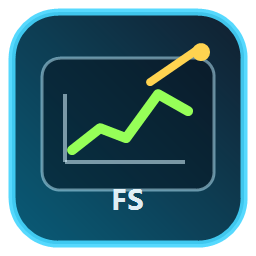
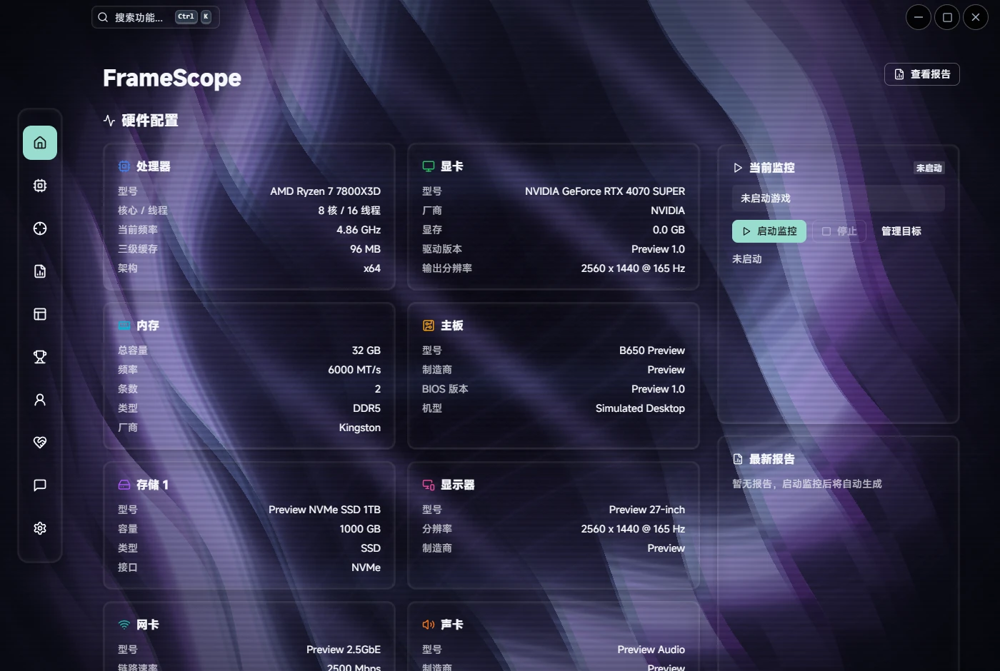
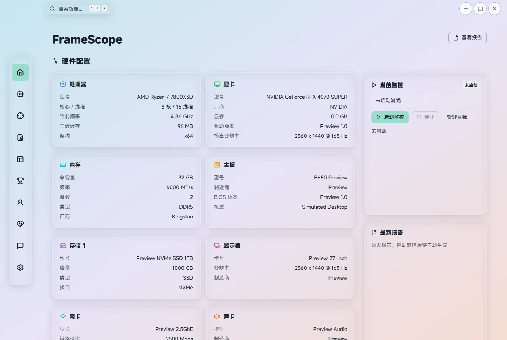
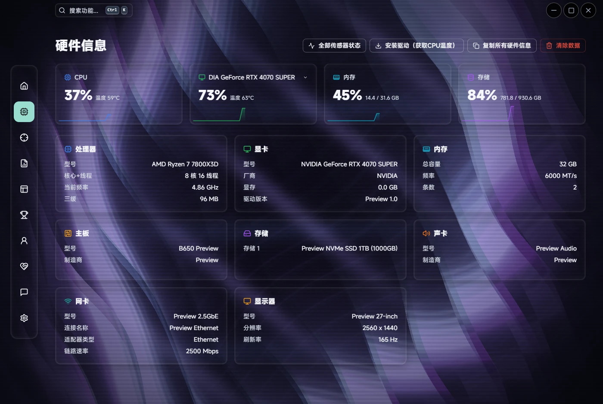
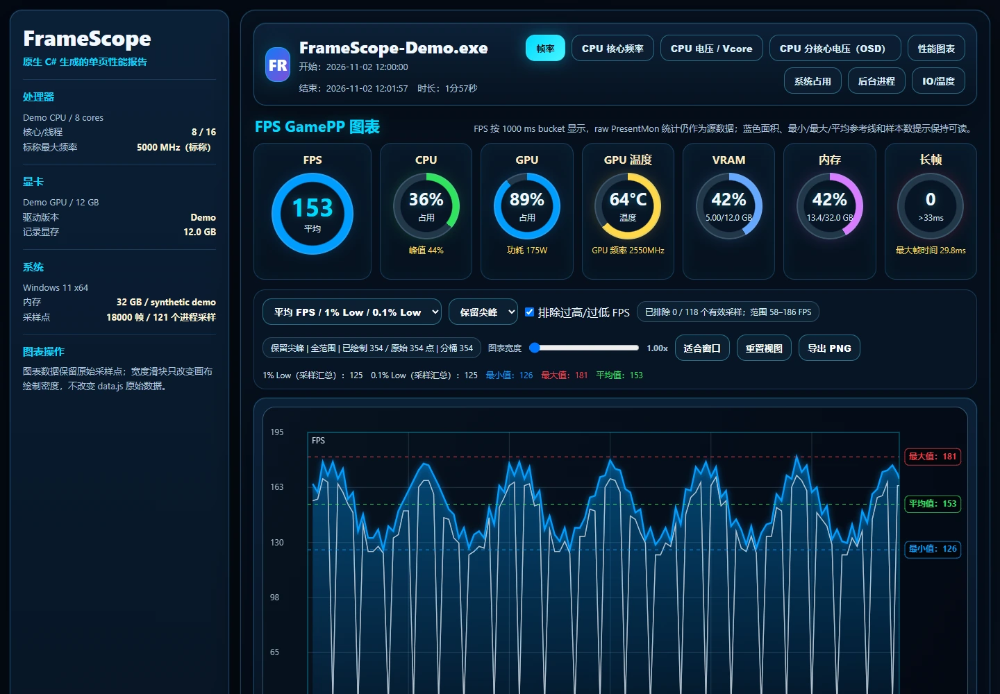
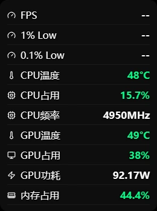
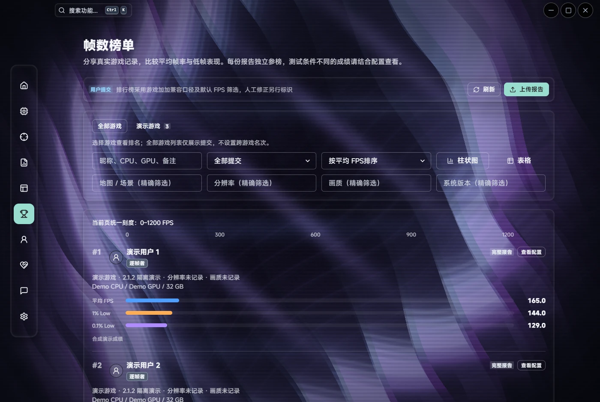

<div align="center">



# FrameScope

Windows 游戏性能监控 · 本地交互报告 · 多形态 OSD · 可定制液态玻璃界面

[](https://github.com/Misakamiro/FrameScopeMonitor/releases/latest)
[](#快速上手)
[](#版型与隐私)
[](LICENSE)

[下载正式版](https://github.com/Misakamiro/FrameScopeMonitor/releases/latest) · [反馈问题](https://github.com/Misakamiro/FrameScopeMonitor/issues) · [源码构建](#从源码构建) · [更新记录](https://github.com/Misakamiro/FrameScopeMonitor/releases)

</div>

FrameScope 是一款 Windows 游戏性能监控工具，支持 FPS、1% Low、0.1% Low、帧时间和硬件监控。游戏中可以用悬浮窗查看数据，结束后可以打开本地网页报告，查看曲线、缩放时间范围，并导出图片。原始 CSV 会保留在本机，方便之后重新生成报告。

当前版本：**2.1.2**。安装包在 [Releases](https://github.com/Misakamiro/FrameScopeMonitor/releases/latest) 下载。本仓库提供离线客户端源码，完整版对应的客户端源码放在发行附件中。

## 界面预览

以下为 2.1.2 界面。主页、硬件和榜单使用演示配置或示例成绩；竖排 OSD 未启动游戏，因此 FPS 和 Low 显示为 `--`。榜单是完整版功能。

<table>
<tr><td width="50%"><br/><b>深色 MR 主页</b> · 动态光带与玻璃卡片</td><td width="50%"><br/><b>浅色透明玻璃</b> · 自定义背景与通透表面</td></tr>
<tr><td><br/><b>硬件监控</b> · 配置与实时传感器</td><td><br/><b>本地交互报告</b> · 查看曲线和筛选数据</td></tr>
<tr><td align="center"><br/><b>竖排 OSD</b> · 可调整显示项、字号和透明度</td><td><br/><b>完整版可选榜单</b> · 示例成绩</td></tr>
</table>

## 主要功能

| 功能 | 说明 |
| --- | --- |
| 自动监控目标 | 配置目标进程，等待游戏启动后采集；按设置在会话结束后生成并打开报告。 |
| FPS / Low / 帧时间 | 显示平均帧率、1% Low、0.1% Low 和帧时间曲线，查看帧率变化和卡顿。 |
| 同时间轴诊断 | 在同一时间范围内查看帧率、进程 CPU／内存／IO 和硬件数据，检查掉帧时的系统状态。 |
| 本地交互报告 | 在浏览器中查看报告，支持缩放、拖动、切换曲线和导出图片。原始 CSV 保存在本机。 |
| 筛选与重新生成 | 报告顶部的“排除过高/过低 FPS”默认开启；可按报告关闭。有原始输入时可重新生成旧报告。 |
| 多形态 OSD | 横向栏、面板与竖排样式；选择显示项、调整字号与透明度、拖动并保存位置。 |
| 硬件信息 | 查看 CPU、GPU、内存、主板、存储等配置，以及可用的温度、频率、功耗和占用。 |
| 外观定制 | 明暗主题、主题色、字体、导航外观、普通／透明液态玻璃、透明度、模糊、弹跳，以及 MR、图片或视频背景。 |
| 签名更新 | 检查正式版或测试版更新，显示下载进度，校验下载文件的签名和哈希，支持安装恢复。 |
| 完整版可选在线功能 | 账号、配置分享、签到、捐助、反馈和成绩榜单。使用这些功能需要完整版。 |

### 报告和 FPS 筛选

报告顶部的“排除过高/过低 FPS”默认开启。你可以关闭它，查看全部有效采样；开关只改变报告统计和曲线，原始 CSV 不变。筛选后会显示有效范围和排除数量，被排除区间连接剩余采样点，时间轴保持不变。

有原始数据的旧报告可以重新生成。没有逐帧数据时，报告仍可展示已采集的进程或硬件信息，Low 项保持缺失。

### 外观和悬浮窗

界面支持明暗主题、普通液态玻璃和透明液态玻璃，也可以设置字体、主题色、透明度、模糊和动画。背景可选 MR 动画、图片或视频。2.1.2 修复了动态背景下文字反复切换黑白的问题。

悬浮窗提供横向栏、面板和竖排三种样式，可以选择监控项目、调整字号和透明度，拖动后保存位置。硬件指标是否可用取决于设备和驱动。

## 与游戏加加对比

游戏加加和 FrameScope 都有 FPS、硬件监控和悬浮显示。FrameScope 主要提供本地数据记录、网页报告和界面定制，适合需要保存原始数据、之后再回看曲线的用户。游戏加加还提供滤镜、跑分等功能，详情可查看 [游戏加加官网](https://www.gamepp.com/)。

| 关注点 | FrameScope | 游戏加加官方介绍 |
| --- | --- | --- |
| 游戏内监控 | FPS / Low、硬件指标与多形态 OSD | FPS、硬件数据、位置及皮肤定制 |
| 游戏结束后的复查 | 本地交互报告、原始 CSV、输入指纹、重新生成与筛选解释 | 性能评估和硬件分析，具体功能以对应版本为准 |
| 可审阅实现 | 本仓库提供离线客户端源码与统计实现 | 以官方公开资料为准 |
| 视觉定制 | 两种液态玻璃、MR、图片／视频、字体、透明度和动画 | 监控皮肤和显示自定义 |
| 画面增强与跑分 | 本项目侧重采集、回看与展示 | 游戏滤镜、电脑跑分等 |

FrameScope 的 FPS／Low 统计参考游戏加加普通 FPS 指标的计算方式。对照两款软件时，需要使用相同的目标、录制区间和帧生成设置；采集源不同也可能导致结果不同。

## 快速上手

1. 前往 [正式版 Releases](https://github.com/Misakamiro/FrameScopeMonitor/releases/latest)，下载 Windows x64 安装包；已有用户可在“设置 → 关于／更新”检查更新。
2. 按安装提示操作；出现管理员权限或硬件驱动安装提示时，确认后继续。
3. 在监控目标中启用游戏进程，启动监控，再自行启动游戏。按需要打开并配置 OSD。
4. 游戏结束后进入“报告”，打开本地网页报告；顶部可切换“排除过高/过低 FPS”。
5. 保留原始记录。向他人分享前检查报告中的设备信息、进程名、路径与窗口标题。

### 系统要求与常见问题

| 问题 | 说明 |
| --- | --- |
| 支持什么系统？ | Windows 10 / 11 x64；主界面需要 Microsoft Edge WebView2 Runtime。 |
| 为什么请求管理员权限？ | ETW 采集、硬件服务和部分传感器需要相应权限；请通过正常 UAC 确认。 |
| PawnIO 是什么？ | 部分底层传感器使用的上游驱动。发行包包含原始安装程序，安装需要用户同意。 |
| 为什么显示 `--`、未知或不可用？ | 传感器、驱动、硬件型号和采集权限影响可用性；缺失的数据显示为 `--` 或不可用。 |
| 独占全屏能显示 OSD 吗？ | 受游戏呈现模式和系统窗口策略影响；不能保证所有独占全屏场景均能覆盖。 |
| 筛选会修改 CSV 吗？ | 不会。筛选偏好按报告保存；完整版榜单始终采用统一默认筛选，与本地开关独立。 |
| 老报告能重新生成吗？ | 有可用原始输入时可以；缺失原始数据的记录不能恢复丢失的帧。请同时保留报告目录中的 HTML、数据 JS 和 manifest 文件。 |
| 离线版是否完全禁止网络？ | 本地采集和报告不要求账号；签名更新、依赖恢复及主动启用的公共信息查询可能联网。详见隐私说明。 |

## 版型与隐私

| 分发内容 | 包含范围 |
| --- | --- |
| 本 GitHub 仓库（`EDITION=offline`） | 本地采集、硬件、OSD、报告、设置和签名更新代码；移除完整版在线专属页面、命令和上传实现。 |
| Releases 安装包 | 以发行说明标注版型；完整版仍通过 GitHub 分发和更新。 |
| Releases 的 `full-client-source.zip` | 对应完整版的净化客户端源码；不包含独立服务端、生产部署配置、凭据、密钥或用户数据。 |

本地采集和报告不要求登录。完整版的账号、反馈和上传功能会连接对应服务，具体说明见 [隐私说明](PRIVACY.md)。分享报告前，请检查设备信息、进程名、路径和窗口标题。

## 从源码构建

主界面使用 Tauri 2、Rust、React 和 Chakra UI，位于 `desktop-preview/`。硬件服务使用 Rust，采集和报告工具使用 C#。`src/frontend/` 是保留的兼容前端，构建 C# 工具时仍会用到。

<details>
<summary>构建环境和命令</summary>

需要 Windows 10／11 x64、PowerShell、.NET Framework 4.x、Node.js、Rust MSVC，以及 Visual Studio C++ Build Tools 和 Windows SDK。请使用单独的源码目录，至少预留 30 GiB 空闲空间。

在仓库根目录执行：

```powershell
./tools/Restore-BuildDependencies.ps1
npm ci --prefix src/frontend
npm run build --prefix src/frontend
npm ci --prefix desktop-preview
$env:CARGO_BUILD_JOBS = '1'
$env:CARGO_INCREMENTAL = '0'
./tools/Package-Installer.ps1 -StageOnly
```

依赖恢复脚本会校验下载归档和每个文件的 SHA256，并提取 WebView2、PawnIO 安装依赖，不执行安装。`-StageOnly` 构建客户端和后端工具，不安装软件或发布版本。宿主产物位于 `desktop-preview/src-tauri/target/release/`。

制作安装包使用 `desktop-preview/installer/build-installer.ps1`，还需要在安装器目录执行 `npm ci`。请保留依赖锁文件和许可证，签名使用自己的密钥。

</details>

<details>
<summary>运行浏览器预览</summary>

```powershell
npm run dev --prefix desktop-preview
```

浏览器预览使用模拟数据，不能代替真实硬件采集或原生悬浮窗验证。

</details>

[GPL-3.0](LICENSE) · [附加声明](desktop-preview/LICENSE.EXTRA) · [第三方声明](THIRD-PARTY-NOTICES.md)

## 致谢

FrameScope 复用并改编了以下项目的成果，感谢作者与维护者：

| 项目 | 在 FrameScope 中的使用 |
| --- | --- |
| [NexBox](https://github.com/MuLiuSaMa/NexBox) | UI 组件、导航、液态玻璃和动画的复用与改编；MR 背景沿用其实现及对 [Mineradio](https://mineradio.cn/) 的来源致谢。GPL-3.0。 |
| [图吧工具箱 WinUI3 / tubatools](https://github.com/luolangaga/tubatools) | ETW FPS 跟踪、事件优先级及去重等采集实现参考与移植。GPL-3.0。 |
| [PresentMon](https://github.com/GameTechDev/PresentMon) | 图形呈现与帧时间采集。MIT。 |
| [LibreHardwareMonitor](https://github.com/LibreHardwareMonitor/LibreHardwareMonitor) | 硬件传感器读取。MPL-2.0。 |
| [PawnIO](https://github.com/namazso/PawnIO) / [PawnIO.Modules](https://github.com/namazso/PawnIO.Modules) | 底层硬件访问及读取模块；驱动 GPL-2.0，模块 LGPL-2.1。 |
| [Tauri](https://github.com/tauri-apps/tauri) / [React](https://github.com/facebook/react) / [Chakra UI](https://github.com/chakra-ui/chakra-ui) | 桌面宿主与界面基础。各组件许可证见项目及锁定依赖。 |

更多依赖和版权信息见 [第三方声明](THIRD-PARTY-NOTICES.md)。
